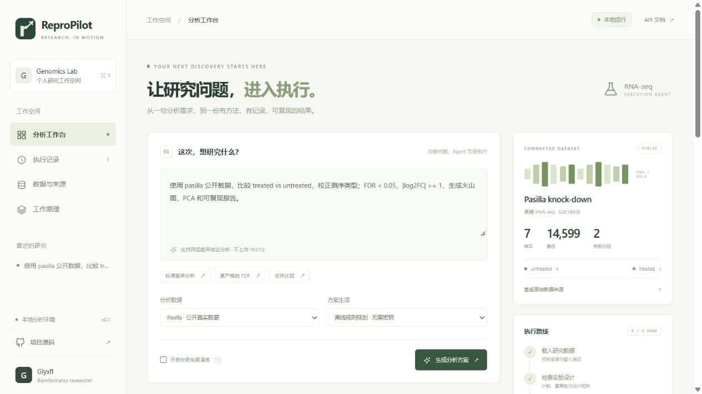
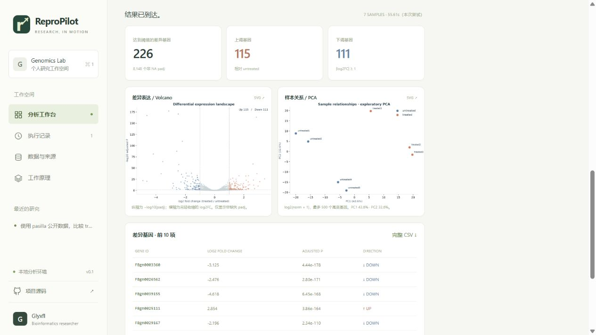

<div align="center">

# ReproPilot

**让研究问题，进入执行。**

A bounded RNA-seq agent that plans, executes, verifies, and delivers reproducible research artifacts.

`Python` · `FastAPI` · `PyDESeq2` · `Human approval` · `Checkpoint recovery`

</div>

ReproPilot 是一个可运行的科研自动化个人项目：用户用自然语言描述两组差异分析任务，确认结构化方案后，系统自动调用固定分析工具，交付结果表、图表、报告、复现脚本和产物校验清单。

> 项目状态：个人研究原型。公开 pasilla 数据用于真实计算，合成数据用于软件验证。没有声称实验室部署、真实客户或节省工时。真实模型规划需要自行配置 API；默认明确标注为离线规则规划。





## 30 秒理解

```text
“比较 treated vs untreated，校正测序类型，FDR < 0.05，输出图表和报告。”
                                  ↓
                  结构化方案 → 研究者确认 → 冻结参数
                                  ↓
     数据指纹 → 设计检查 → PyDESeq2 → 图表 → 报告 → 产物验收
                                  ↓
             ZIP：CSV + PNG/SVG + HTML/Markdown + replay script + manifest
```

## 为什么做这个项目

RNA-seq 分析中，可计算的工作经常分散在聊天、脚本、图表和交付目录之间。对于两组比较这种边界明确的任务，值得自动化的部分是**从分析意图到可验收产物的执行与交付**。

ReproPilot 的产品假设是：实验人员提出问题，分析人员确认方法，执行系统完成重复流程并保留证据。这个假设需要后续真实访谈和试用来验证，详见 [产品设计](docs/PRODUCT.md)。

## 实际实现了什么

| 能力 | 实现 |
| --- | --- |
| 任务理解 | 离线受限规则解析；可选兼容 Chat Completions JSON 输出的真实模型 |
| 方案约束 | Pydantic 参数白名单、分组验证、不允许模型输出可执行代码 |
| 人工确认 | SHA-256 冻结方案，数据库原子状态转换避免重复启动 |
| 科学计算 | PyDESeq2 负二项模型、Wald 检验、Benjamini–Hochberg FDR |
| 自动交付 | 差异结果、归一化计数、火山图、探索性 PCA、报告、统计复现脚本 |
| 失败恢复 | 统计检查点包含输入与结果哈希；重试先验证，再复用 |
| 可追溯 | 固定来源数据、SQLite 工具事件、参数、版本、输入与产物 SHA-256 |
| 前端 | 响应式工作台、方案确认、6 阶段状态、执行历史、图表与下载 |
| 验证 | 单元/API/并发/完整分析恢复与复现测试；GitHub Actions 已配置 |

## 本地启动

需要 Python **3.11–3.13**。首次安装需要联网；安装后，离线模式的分析不访问外部服务。

```bash
git clone https://github.com/Glyxfl/repropilot.git
cd repropilot
python -m venv .venv
```

Windows PowerShell：

```powershell
.\.venv\Scripts\python.exe -m pip install -r requirements.txt
.\.venv\Scripts\python.exe run.py
```

macOS / Linux：

```bash
.venv/bin/python -m pip install -r requirements.txt
.venv/bin/python run.py
```

浏览器打开 **http://127.0.0.1:8765**。Windows 完成安装后也可以双击 `start.cmd`。

按页面默认任务点击「生成分析方案」→「确认并执行」。首次导入科学计算库可能较慢；工作进程最多执行 300 秒。

Docker（可选，未在本次 Windows 环境验证）：

```bash
docker build -t repropilot .
docker run --rm -p 127.0.0.1:8765:8765 repropilot
```

## 接入真实模型

复制 `.env.example` 为 `.env`，在**服务端本地**配置：

```dotenv
MODEL_BASE_URL=https://api.deepseek.com
MODEL_NAME=your-model-name
MODEL_API_KEY=your-key
```

重启服务，在页面选择「真实大模型」。`MODEL_BASE_URL` 填接口前缀，程序会追加 `/chat/completions`；使用含 `/v1` 的服务时请自行包含该段。服务需支持 `response_format: {"type":"json_object"}`。

模型只接收任务文本、固定公开数据集描述和参数 schema，不接收原始计数矩阵。无配置、超时、非法 JSON 或越界参数会明确报错，不会伪装成成功的模型调用。不要在任务文本粘贴密钥或受限研究信息。

适配器按 [DeepSeek JSON Output 文档](https://api-docs.deepseek.com/guides/json_mode/) 实现；本项目本次没有使用付费密钥调用真实服务，相关响应边界通过模拟接口测试。

## 3 分钟演示

1. 选择 **Pasilla · 公开真实数据**，生成默认差异分析方案。
2. 解释比较方向、`~ library_type + condition` 和显著性阈值，确认执行。
3. 观察 6 个真实工具阶段，查看结果和工具证据，下载交付包。
4. 选择 **Synthetic · 合成演练数据**，勾选「开启失败恢复演练」。首次图表阶段会主动失败。
5. 点击「从检查点重试」，展示 `fit_deseq2 / cached` 及成功交付。
6. 解压 ZIP，在目录中运行 `python reproduce.py`；结果写入 `replay/`。

完整讲解见 [演示与面试材料](docs/CAREER.md)。

## 分析方法与边界

- 输入为 **gene-level 原始整数计数**，不是 FASTQ、TPM 或 FPKM。
- 公开数据为果蝇 pasilla / **GSE18508**，7 样本，14,599 基因；保留上游原始文件和固定 commit、SHA-256。
- 默认预过滤：至少 3 个样本计数 ≥ 10；默认设计 `~ library_type + condition`。
- 设计矩阵不满秩、重复数不足、非整数计数会阻止执行，不会自动删样本或改模型。
- 差异标准为 `padj < alpha` 且 `|未收缩 log2FC| >= threshold`，不是对 log2FC 阈值本身的复合假设检验。
- Cook's filtering 与 independent filtering 开启；NA padj 不计入发现数；未执行 LFC shrinkage。
- PCA 是 `log2(normalized counts + 1)` 的最多 500 个高变基因的探索性投影，**不是 VST、也没有批次去除**。
- 当前支持固定数据集、两组比较；未实现富集、单细胞、GEO 自动发现、多用户或集群调度。
- 执行采用固定工具的本地子进程和超时限制，**不等于容器级隔离**。当前为本地单用户原型，无公网认证，不应直接暴露到 Internet。

## 验证

```bash
python -m unittest discover -v
```

测试覆盖参数解析、超范围请求、模型错误响应、混杂设计阻断、重复确认保护、跨域请求阻断、真实 PyDESeq2 拟合、一次故障后的恢复、交付哈希与统计结果回放。具体执行环境和实测结果见 [验证记录](docs/VALIDATION.md)。

环境可以用范围约束的 `requirements.txt` 安装；`requirements-lock.txt` 记录本次 Windows / Python 3.13 的完整依赖快照。跨平台默认用 `requirements.txt`，每个交付包也会保存实际核心依赖版本。

## 仓库地图

```text
repropilot/
  planner.py      # 受限自然语言规划 / 真实模型适配器
  models.py       # 参数契约
  server.py       # API、确认门、执行调度、产物边界
  pipeline.py     # 分析工具、检查点、图表、报告与验收
  store.py        # SQLite 状态机与事件
  datasets.py     # 固定公开数据 / 可复现合成数据
web/              # 前端，无构建步骤
data/             # 原始公开计数、注释和来源指纹
tests/            # 包含实际统计回放的测试
docs/             # 产品、架构、验证、求职演示
scripts/          # 固定统计复现脚本模板
runtime/          # 本地任务和结果，已被 Git 忽略
```

## 设计文档

- [产品设计与验证计划](docs/PRODUCT.md)
- [架构、状态机与技术取舍](docs/ARCHITECTURE.md)
- [验证记录](docs/VALIDATION.md)
- [简历写法、面试演示与下一步](docs/CAREER.md)

## 数据与引用

上游 [Bioconductor pasilla](https://bioconductor.org/packages/pasilla/) 数据包描述了 Brooks et al. (2011), Genome Research 的 Pasilla knock-down 实验。原始文件来自 [bioc/pasilla](https://github.com/bioc/pasilla)，固定来源见 [data/provenance.json](data/provenance.json)。上游声明 LGPL，`data/` 保留上游说明，其条款独立于本项目代码。

统计工具参考 [PyDESeq2 文档](https://pydeseq2.readthedocs.io/en/stable/auto_examples/plot_minimal_pydeseq2_pipeline.html)；模型设计局限参考 [DESeq2 vignette](https://bioconductor.org/packages/release/bioc/vignettes/DESeq2/inst/doc/DESeq2.html)。PyDESeq2 是独立 Python 实现，本项目不声称与 R DESeq2 在所有情形下数值一致。

项目自有代码使用 MIT License。
