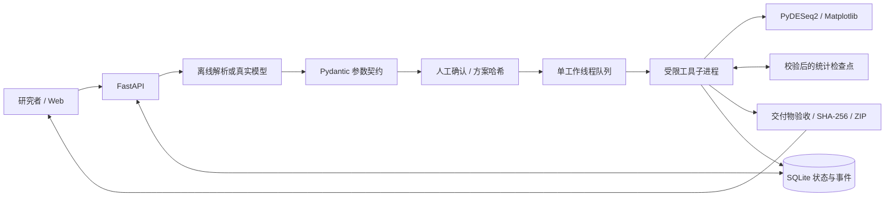
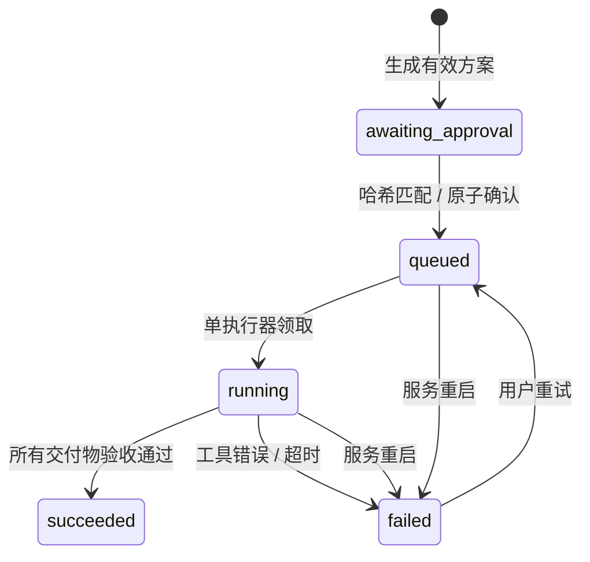

# 架构与技术取舍

## 执行边界

模型只有一个能力：提出 Plan 参数。工具序列是应用定义的固定 DAG，不是开放式自主 Agent。计划 schema 不含代码、文件路径、命令、URL 或自定义公式；未知字段被拒绝。模型不能选择新的数据来源或越过人工确认。

实际执行器只运行仓库内固定的 `repropilot.worker`，不执行模型返回的 Python。子进程限制为 300 秒，单次科学计算 CPU 线程数为 1。父进程不把名称含 token、secret、api_key、password 的环境变量传给工作进程。这个筛选不是机密隔离的完整保证，也不是 OS sandbox。

## 状态机

SQLite 的 `UPDATE ... WHERE status=expected` 实现 compare-and-swap。同一方案重复确认只能有一个请求进入队列。方案不能原地编辑；新任务产生新的 run 与哈希。

服务重启会将 queued/running 标为 failed，不会悄悄重新执行。已确认过的失败任务可以重试。线程队列不耐进程崩溃，不适合多进程横向扩展；生产版本应替换为持久队列与租约。

## 6 个固定工具

| 工具 | 前置条件与产物 |
| --- | --- |
| inspect_dataset | 验证公开原始文件 SHA-256；输出对齐计数和元数据 |
| validate_design | 验证整数、非负、重复标识、重复数、矩阵秩与残差自由度 |
| fit_deseq2 | 低表达过滤、拟合、Wald、FDR；保存统计检查点 |
| render_figures | 从统计 CSV 与归一化计数生成真实 PNG/SVG |
| write_report | 只从已计算指标生成固定报告和复现脚本 |
| verify_delivery | 文件非空、PNG 可解码、产物哈希；打包 ZIP |

## 恢复语义

统计阶段结束后，检查点记录冻结方案哈希以及 counts、metadata、normalized_counts、differential_expression、fit_summary 的 SHA-256。重试重新读取输入，只有全部匹配才标记 `cached`。任一产物被修改就重新拟合。

首次图表失败演练是显式的一次性故障注入，写入本地标记后抛出错误。它不修改输入、阈值、模型或结果。重试不自动选择其他统计方法。

检查点同时记录分析工具源文件与核心依赖版本的组合指纹。工具实现或核心统计依赖改变时，旧检查点失效并重新拟合，不会跨版本静默复用。

## API 契约

- `POST /api/runs`：创建待确认方案；无计算副作用。
- `POST /api/runs/{id}/approve`：校验 plan_hash 后原子排队。
- `POST /api/runs/{id}/retry`：仅失败任务可重试。
- `GET /api/runs/{id}`：读取状态、参数、摘要、工具事件。
- `GET /api/runs/{id}/artifacts/{name}`：仅 succeeded 状态提供白名单产物。
- `GET /api/datasets`：公开数据目录。
- `/docs`：OpenAPI 文档。

原型默认仅接受本地主机 Host，跨源写入被拒绝，无宽松 CORS。不具备用户认证、计费和公网访问能力。

## 交付包与复现

输入、参数、核心依赖版本和分析摘要随包保存。统计复现脚本是仓库固定模板，输出写到独立 replay 目录，不覆盖原交付。

图表为 PNG + SVG；报告为 HTML + Markdown。manifest 记录主要产物 SHA-256；trace 保留工具事件。manifest 用于完整性检查，不是有密钥签名的不可篡改审计。

## 为什么使用这些技术

FastAPI 提供参数校验和可检查的 API；PyDESeq2 使部署不依赖 R 环境；SQLite 使个人原型易于运行与观察；无构建前端减少招聘方的安装步骤。技术复杂度集中在执行、方法边界、状态与交付验证。

没有为展示堆叠向量数据库、多个角色 Agent 或生成代码执行。这些组件只有在明确解决用户问题时才应引入。
